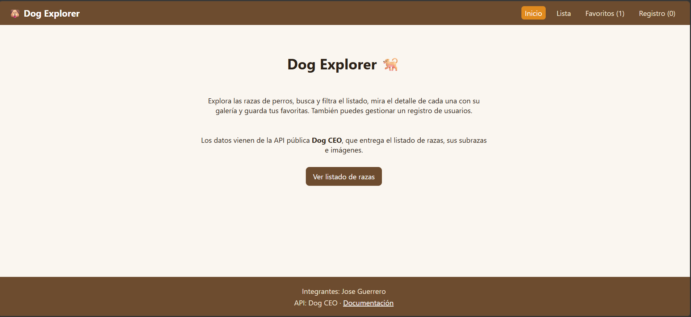
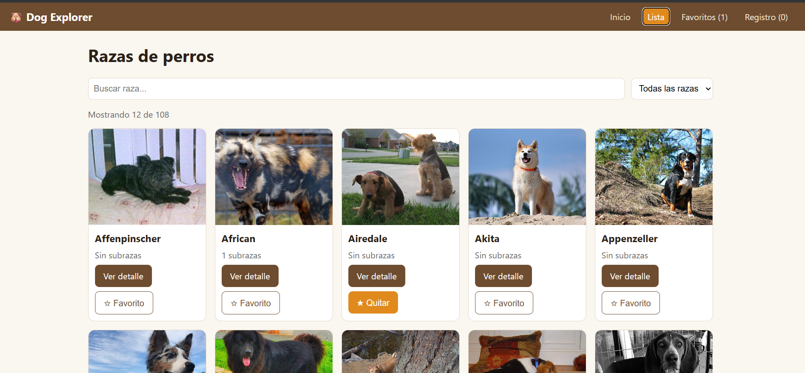
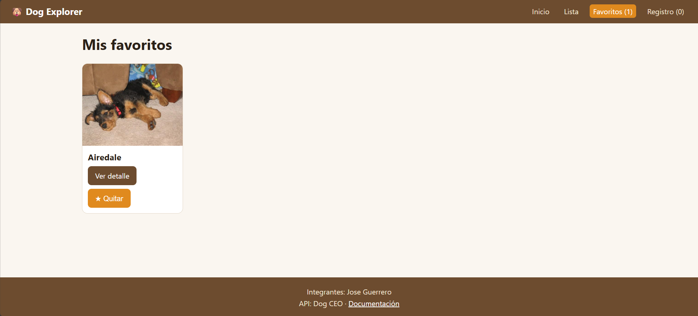
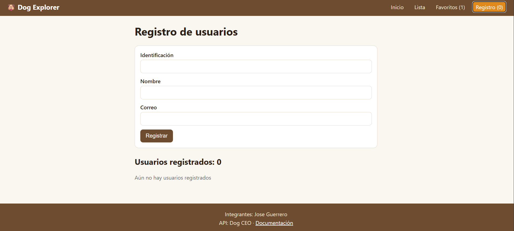

# Dog Explorer

Aplicación web en React (Vite) para explorar razas de perros, guardar favoritos y gestionar un registro de usuarios.

## capturas de pantalla





## API utilizada

- **Nombre:** Dog CEO – Dog API
- **URL base:** `https://dog.ceo/api`
- **Documentación:** https://dog.ceo/dog-api/documentation


| Uso | Endpoint |
| --- | --- |
| Listado de razas | `GET /breeds/list/all` |
| Imágenes de una raza (detalle, parámetro `raza`) | `GET /breed/{raza}/images` |
| Imagen de una raza para las tarjetas | `GET /breed/{raza}/images/random` |

## Rutas

`/`, `/lista`, `/detalle/:id`, `/favoritos`, `/registro` y `*` (404).

## Ejecutar

```bash
npm install
npm run dev
```

## Publicación

`npm run build` genera `dist/`. Se puede desplegar en Vercel o Netlify (incluye `vercel.json` para las rutas del SPA).

## Integrantes

- Jose Guerrero
